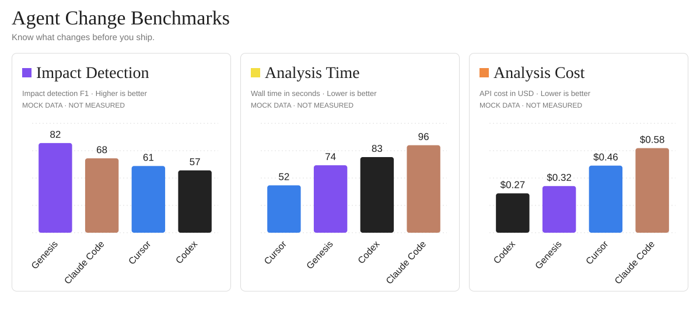

<p align="center">
  <a href="https://usegenesis.vercel.app/"></a>&nbsp;&nbsp;
  <picture>
    <source media="(prefers-color-scheme: dark)" srcset="assets/readme/wordmark-dark.svg">
    
  </picture>
</p>

<h1 align="center">Salvaguardas para cada cambio en tu agente.</h1>

<p align="center">
  <a href="https://usegenesis.vercel.app/">Sitio web</a> &nbsp;·&nbsp;
  <a href="#genesis-get-started"><strong>Primeros pasos</strong></a> &nbsp;·&nbsp;
  <a href="#genesis-docs">Documentación</a> &nbsp;·&nbsp;
  <a href="#genesis-stars">Historial de estrellas</a>
</p>

<p align="center"><a href="README.md">English</a> &nbsp;·&nbsp; <a href="README.zh-CN.md">简体中文</a> &nbsp;·&nbsp; <a href="README.ja.md">日本語</a> &nbsp;·&nbsp; <a href="README.ko.md">한국어</a> &nbsp;·&nbsp; <a href="README.de.md">Deutsch</a> &nbsp;·&nbsp; <a href="README.fr.md">Français</a> &nbsp;·&nbsp; <strong>Español</strong></p>

<p align="center">
  <a href="https://github.com/GenesisAgentInfra/genesis-cli/stargazers"></a>
  <a href="https://github.com/GenesisAgentInfra/genesis-cli/blob/main/LICENSE"></a>
  <a href="https://github.com/GenesisAgentInfra/genesis-cli/blob/main/docs/coding-agents.md"></a>
  <a href="https://github.com/GenesisAgentInfra/genesis-cli#what-your-review-covers"></a>
  <a href="https://github.com/GenesisAgentInfra/genesis-cli/blob/main/packages/genesis_ci/pyproject.toml"></a>
</p>

<p align="center">
  <a href="https://github.com/GenesisAgentInfra/genesis-cli/blob/main/docs/coding-agents.md">
    <picture>
      <source media="(max-width: 600px) and (prefers-reduced-motion: reduce)" srcset="assets/readme/code-intelligence-animation-mobile-poster.png">
      <source media="(max-width: 600px)" srcset="assets/readme/code-intelligence-animation-mobile.gif">
      <source media="(prefers-reduced-motion: reduce)" srcset="assets/readme/code-intelligence-animation-poster.png">
      
    </picture>
  </a>
</p>

<p align="center"><sub><a href="https://github.com/GenesisAgentInfra/genesis-cli/blob/main/docs/coding-agents.md">Ilustración del proceso de revisión</a></sub></p>

<a id="genesis-benchmarks"></a>

## Comparativa

<picture>
  <source media="(max-width: 600px)" srcset="assets/readme/benchmark-preview-mobile.svg">
  
</picture>

## Por qué necesitas Genesis

Entiende cómo un cambio de código afecta al resultado que recibe el usuario.

| Impacto para el usuario | Qué te ayuda a revisar Genesis |
| --- | --- |
| **El agente sigue trabajando. El resultado nunca llega.** [Fuente](https://github.com/openai/openai-agents-python/issues/191) | Cambios en las condiciones de finalización y salida. |
| **El usuario dice «no». La acción se ejecuta igual.** [Fuente](https://github.com/langchain-ai/langchain/issues/40492) | Cambios en los controles de aprobación y las rutas de ejecución. |
| **Una solicitud. La misma acción ocurre dos veces.** [Fuente](https://github.com/langchain-ai/langgraph/issues/9185) | Rutas de reintento y controles contra acciones duplicadas. |
| **La misma tarea consume más tokens.** [Fuente](https://github.com/microsoft/agent-framework/issues/5049) | Crecimiento del prompt y llamadas adicionales al modelo. |
| **Las tareas se completan. Tus usuarios esperan más.** [Fuente](https://github.com/openai/openai-agents-python/issues/2386) | Llamadas bloqueantes y pasos secuenciales. |

<a id="genesis-get-started"></a>

## Empieza desde tu agente de programación

La CLI y el análisis estático son de código abierto. La revisión semántica usa
el servicio alojado de Genesis, con tu aprobación antes de enviar código fuente.

### 1. Instala una sola vez

Pega esta solicitud en Codex o Claude Code dentro del proyecto que quieras revisar:

```text
Configura Genesis desde https://github.com/GenesisAgentInfra/genesis-cli.
Lee el README y docs/coding-agents.md. Instala la CLI fuera de este proyecto y el
skill genesis-review para mi agente actual con alcance de usuario. Reutiliza la
instalación existente y actualiza, si hace falta, un skill administrado sin modificaciones.
Sigue "Configure CR preparation in this project" en docs/coding-agents.md:
añade a las instrucciones de este proyecto la revisión con Genesis antes de preparar una CR/PR,
preservando el contenido existente. Verifica CLI, skill y regla; indica qué archivo cambió.
Por ahora solo configura: no analices ni subas código. Los envíos futuros requieren
autorización que cubra el servicio de destino y las fuentes seleccionadas.
```

**Después de configurar:** pide al agente « Prepara estos cambios para revisión de código ». Las instrucciones del proyecto
le indican que ejecute Genesis y explique el resultado antes de finalizar la descripción de la CR/PR. No requiere GitHub CI.
Es una instrucción para el agente, no una garantía de ejecución, un hook de Git ni un bloqueo de merge. El skill se instala
para el usuario; esta regla se aplica al proyecto actual. Instalar solo la CLI no añade la regla.
[Configuración manual, actualización y eliminación](docs/coding-agents.md#configure-cr-preparation-in-this-project).

<details>
<summary>Instalación manual</summary>

Ejecuta estos comandos fuera de la aplicación que quieras revisar:

```sh
git clone https://github.com/GenesisAgentInfra/genesis-cli.git
cd genesis-cli
uv sync --python 3.12 --package genesis-ci --no-dev --frozen
uv run --package genesis-ci --no-dev --frozen genesis version
uv run --package genesis-ci --no-dev --frozen genesis agent install --agent codex
uv run --package genesis-ci --no-dev --frozen genesis agent status --agent codex
```

</details>

### 2. Solicita una revisión

```text
Prepara estos cambios para revisión de código (CR/PR), siguiendo la instrucción de Genesis de este proyecto.
Explica los hallazgos y lo que falta verificar antes de finalizar la descripción. Muestra el alcance de la subida antes de enviar.
```

También puedes seleccionar el skill de forma explícita:

| Agente | Invocación |
| --- | --- |
| Codex | `$genesis-review` seguido de tu solicitud |
| Claude Code | `/genesis-review` seguido de tu solicitud |

Indica una comparación de ramas o un par de commits si quieres revisar otro
alcance. Las descripciones de tareas y los mapas de flujo son contexto opcional.

La prueba compartida oficial funciona sin `genesis auth` cuando no hay ajustes
de conexión personales configurados. Usa una cuota limitada compartida por
todos los usuarios. No requiere una clave API de un proveedor de modelos.
[Acceso y límites de la prueba](https://github.com/GenesisAgentInfra/genesis-cli/blob/main/docs/usage.md#default-shared-trial).

## Qué cubre tu revisión

| Área | Qué obtienes |
| --- | --- |
| Comportamiento de negocio | Evidencia del antes y el después que muestra cómo puede cambiar el comportamiento de la aplicación. |
| Rutas afectadas | Los puntos de llamada y las rutas de código relacionados con el cambio, junto con los mapas de flujo que se hayan proporcionado. |
| Coste, espera y fallos | Riesgos condicionales y estimaciones estáticas cuando la evidencia disponible los respalda. |
| Pruebas | Qué comprueba el código fuente de las pruebas relacionadas y qué aserciones podrían faltar. |
| Verificación | Comprobaciones sugeridas y aspectos que aún necesitan evidencia. |

## De tu cambio al informe

1. **Prepara en local.** Genesis captura los cambios elegidos y extrae evidencia
   del código. Tu agente muestra los fragmentos de código fuente y los hechos
   seleccionados para el envío.
2. **Aprueba el envío.** Con tu autorización, Genesis envía ese material a su
   servicio alojado. También puedes mantener el análisis en local y recibir
   un informe parcial.
3. **Lee los resultados en el chat.** Tu agente explica el informe, comprueba
   su evidencia y su estado, e identifica qué falta por verificar.

Los informes se guardan en `.genesis/analyses/<run-id>/`, dentro de tu proyecto:

- `summary.md`: empieza por el resumen legible.
- `report.md`: examina los resultados detallados, la evidencia y los estados.
- `report.json`: usa el resultado estructurado en tus propias herramientas.

Códigos de salida: **0** significa que el análisis se completó dentro del alcance
declarado; **2** indica un informe parcial utilizable; **1** significa que no se
pudo producir el resultado solicitado. Excluye `.genesis/` de Git: puede contener
código fuente capturado.

## Código fuente y servicio

El repositorio público contiene la CLI y el análisis estático. El equipo de
Genesis opera el servicio semántico privado; su implementación de servidor no
se incluye para alojarla por tu cuenta.

La vista previa y el análisis sin conexión se realizan en local. Instalar el
skill no activa revisiones automáticas después de cada edición.

[Tratamiento de datos, claves personales y configuración](https://github.com/GenesisAgentInfra/genesis-cli/blob/main/docs/usage.md).

<a id="genesis-docs"></a>

## Documentación

- [Guía para agentes de programación](https://github.com/GenesisAgentInfra/genesis-cli/blob/main/docs/coding-agents.md): configuración, detección del skill, instrucciones de equipo y solución de problemas.
- [Guía de la CLI](https://github.com/GenesisAgentInfra/genesis-cli/blob/main/docs/usage.md): comandos, contexto opcional, credenciales y tratamiento de datos.
- [GitHub Action](https://github.com/GenesisAgentInfra/genesis-cli/blob/main/docs/github-action.md): configura la automatización del repositorio; el análisis alojado requiere una clave Genesis proporcionada explícitamente.
- [Contribuir](https://github.com/GenesisAgentInfra/genesis-cli/blob/main/CONTRIBUTING.md): desarrolla y prueba el cliente.
- [Límites del repositorio](https://github.com/GenesisAgentInfra/genesis-cli/blob/main/docs/repository-boundary.md) y [esquemas de los informes](https://github.com/GenesisAgentInfra/code-intelligence-protocol).

<a id="genesis-stars"></a>

## Historial de estrellas

<a href="https://www.star-history.com/#GenesisAgentInfra/genesis-cli&amp;Date">
  <picture>
    <source media="(prefers-color-scheme: dark)" srcset="https://api.star-history.com/svg?repos=GenesisAgentInfra/genesis-cli&amp;type=Date&amp;theme=dark">
    
  </picture>
</a>

[Ver en Star History](https://www.star-history.com/#GenesisAgentInfra/genesis-cli&Date)


## Licencia

El código original de Genesis CLI se distribuye bajo la licencia [Apache-2.0](https://github.com/GenesisAgentInfra/genesis-cli/blob/main/LICENSE).
Esta licencia no concede acceso al servicio Genesis, que se opera por separado.
Los componentes incluidos conservan sus propias licencias; consulta [NOTICE](https://github.com/GenesisAgentInfra/genesis-cli/blob/main/NOTICE)
y los [avisos de terceros](https://github.com/GenesisAgentInfra/genesis-cli/blob/main/THIRD_PARTY_NOTICES.md).
