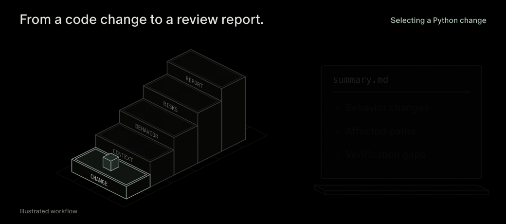
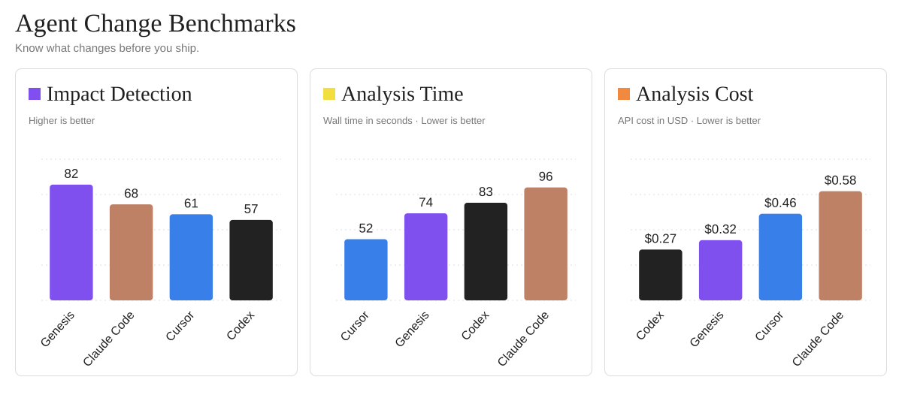

<p align="center">
  <a href="https://usegenesis.vercel.app/"></a>&nbsp;&nbsp;
  <picture>
    <source media="(prefers-color-scheme: dark)" srcset="assets/readme/wordmark-dark.svg">
    
  </picture>
</p>

<h1 align="center">あなたのエージェントのあらゆる変更に、ガードレールを。</h1>

<p align="center">
  <a href="https://usegenesis.vercel.app/">公式サイト</a> &nbsp;·&nbsp;
  <a href="#genesis-get-started"><strong>使い始める</strong></a> &nbsp;·&nbsp;
  <a href="#genesis-docs">ドキュメント</a> &nbsp;·&nbsp;
  <a href="#genesis-stars">スター履歴</a>
</p>

<p align="center"><a href="README.md">English</a> &nbsp;·&nbsp; <a href="README.zh-CN.md">简体中文</a> &nbsp;·&nbsp; <strong>日本語</strong> &nbsp;·&nbsp; <a href="README.ko.md">한국어</a> &nbsp;·&nbsp; <a href="README.de.md">Deutsch</a> &nbsp;·&nbsp; <a href="README.fr.md">Français</a> &nbsp;·&nbsp; <a href="README.es.md">Español</a></p>

<p align="center">
  <a href="https://github.com/GenesisAgentInfra/genesis/stargazers"></a>
  <a href="https://github.com/GenesisAgentInfra/genesis/blob/main/LICENSE"></a>
  <a href="https://github.com/GenesisAgentInfra/genesis/blob/main/docs/coding-agents.md"></a>
  <a href="https://github.com/GenesisAgentInfra/genesis#what-your-review-covers"></a>
  <a href="https://github.com/GenesisAgentInfra/genesis/blob/main/packages/genesis_ci/pyproject.toml"></a>
</p>

<p align="center">
  <a href="https://github.com/GenesisAgentInfra/genesis/blob/main/docs/coding-agents.md">
    <picture>
      <source media="(max-width: 600px) and (prefers-reduced-motion: reduce)" srcset="assets/readme/code-intelligence-animation-mobile-poster.png">
      <source media="(max-width: 600px)" srcset="assets/readme/code-intelligence-animation-mobile.gif">
      <source media="(prefers-reduced-motion: reduce)" srcset="assets/readme/code-intelligence-animation-poster.png">
      
    </picture>
  </a>
</p>

<p align="center"><sub><a href="https://github.com/GenesisAgentInfra/genesis/blob/main/docs/coding-agents.md">コードレビューの流れ</a></sub></p>

<a id="genesis-benchmarks"></a>

## ベンチマーク

<picture>
  <source media="(max-width: 600px)" srcset="assets/readme/agent-change-benchmarks-mobile.svg">
  
</picture>

## Genesis が必要な理由

コードの変更が、ユーザーに届く結果をどう変えるかを確認します。

| ユーザーへの影響 | Genesis がレビューを支援する内容 |
| --- | --- |
| **エージェントは動き続ける。でも結果が届かない。** [出典](https://github.com/openai/openai-agents-python/issues/191) | タスクの完了条件と停止条件の変更。 |
| **ユーザーが拒否しても、操作が実行される。** [出典](https://github.com/langchain-ai/langchain/issues/40492) | 承認チェックと操作の実行経路の変更。 |
| **依頼は一度。同じ操作が二度実行される。** [出典](https://github.com/langchain-ai/langgraph/issues/9185) | 再試行経路と重複操作を防ぐチェック。 |
| **同じタスクなのに、トークン消費が増える。** [出典](https://github.com/microsoft/agent-framework/issues/5049) | プロンプトの肥大化とモデル呼び出しの追加。 |
| **タスクは完了する。でも待ち時間が延びる。** [出典](https://github.com/openai/openai-agents-python/issues/2386) | ブロッキング呼び出しと逐次実行のステップ。 |

<a id="genesis-get-started"></a>

## コーディングエージェントで使い始める

CLI と静的解析はオープンソースです。意味解析を伴うレビューには Genesis のホスト型サービスを使用します。ソースコードを送信する前に、ユーザーの承認を得ます。

### 1. 初回セットアップ

レビューしたいプロジェクトで Codex または Claude Code を開き、次の依頼を貼り付けてください。

```text
https://github.com/GenesisAgentInfra/genesis から Genesis をセットアップしてください。
README と docs/coding-agents.md を読み、CLI はプロジェクト外に、genesis-review
スキルは現在のエージェントのユーザースコープにインストールしてください。
既存のインストールは再利用し、未編集の管理対象スキルは必要に応じて更新してください。
docs/coding-agents.md#configure-cr-preparation-in-this-project の設定手順に従い、
既存の内容を保持して、このプロジェクトのエージェント指示に CR/PR 準備前の
Genesis レビューを追加してください。CLI、スキル、指示を確認し、変更したファイルを報告してください。
今回は設定のみです。レビューやアップロードは行わず、今後の送信にも対象サービスとソースを含む承認が必要です。
```

**設定後：**「この変更をコードレビューに出す準備をして」と依頼すると、プロジェクトの指示により、
エージェントは CR/PR の説明を仕上げる前に Genesis を実行して結果を説明します。GitHub CI は不要です。
これはエージェントへの指示であり、実行保証、Git hook、マージ制限ではありません。スキルはユーザー単位、
この設定は現在のプロジェクト単位です。CLI のインストールだけでは追加されません。
[手動設定・更新・解除](docs/coding-agents.md#configure-cr-preparation-in-this-project)。

<details>
<summary>手動でインストールする</summary>

レビュー対象のアプリケーションの外で、次のコマンドを実行してください。

```sh
git clone https://github.com/GenesisAgentInfra/genesis.git
cd genesis
uv sync --python 3.12 --package genesis-ci --no-dev --frozen
uv run --package genesis-ci --no-dev --frozen genesis version
uv run --package genesis-ci --no-dev --frozen genesis agent install --agent codex
uv run --package genesis-ci --no-dev --frozen genesis agent status --agent codex
```

</details>

### 2. レビューを依頼する

```text
この変更を CR/PR に出す準備をしてください。プロジェクトの Genesis レビュー指示に従い、
結果と未検証の点を説明してからレビューの説明文を仕上げてください。送信前にアップロード範囲を見せてください。
```

スキルを明示的に選択することもできます。

| エージェント | 呼び出し方 |
| --- | --- |
| Codex | `$genesis-review` に続けて依頼を入力 |
| Claude Code | `/genesis-review` に続けて依頼を入力 |

別の範囲をレビューしたい場合は、比較するブランチやコミットの組を指定してください。タスクの説明やフローマップは、任意で追加できるコンテキストです。

個人用の接続設定がない場合は、`genesis auth` を実行せずに公式の共有トライアルを利用できます。利用枠には上限があり、すべてのユーザーで共有します。モデルプロバイダーの API キーは不要です。
[アクセス方法とトライアルの制限](https://github.com/GenesisAgentInfra/genesis/blob/main/docs/usage.md#default-shared-trial)。

## レビューで確認できること

| 領域 | 得られる情報 |
| --- | --- |
| 業務上の振る舞い | アプリケーションの振る舞いがどう変わり得るかを示す、変更前後の証拠。 |
| 影響を受ける経路 | 変更に関連する呼び出し元やコード経路、および提供されたフローマップ。 |
| コスト、待ち時間、失敗 | 利用可能な証拠で裏付けられる範囲の、条件付きのリスクと静的な見積もり。 |
| テスト | 関連するテストのソースが何を検証しているか、どのアサーションが不足している可能性があるか。 |
| 検証 | 推奨する確認事項と、まだ証拠が足りない点。 |

## 変更からレポートまで

1. **ローカルで準備する。** Genesis が選択した変更を取り込み、コードの証拠を抽出します。エージェントが、アップロード対象に選ばれたソースの抜粋と事実を提示します。
2. **アップロードを承認する。** ユーザーの許可を得て、Genesis がその資料をホスト型サービスに送信します。解析をローカルに限定し、部分的なレポートを受け取ることもできます。
3. **チャットで結果を読む。** エージェントがレポートを説明し、証拠とステータスを確認して、まだ検証が必要な点を示します。

レポートは、プロジェクト内の `.genesis/analyses/<run-id>/` に保存されます。

- `summary.md`: まず、読みやすい要約から確認してください。
- `report.md`: 詳細な指摘、証拠、ステータスを確認できます。
- `report.json`: 構造化された結果を自分のツールで利用できます。

終了コードは、**0** が明示された範囲内での完了、**2** が利用可能な部分レポートの生成、**1** が要求された結果を生成できなかったことを表します。`.genesis/` には取り込んだソースが含まれる場合があるため、Git に追加しないでください。

## ソースコードとサービス

公開リポジトリには、CLI と静的解析が含まれています。意味解析サービスは Genesis チームが非公開の実装として運用しており、セルフホスト用のサーバー実装は含まれていません。

プレビューとオフライン解析はローカルで完結します。スキルをインストールしても、編集のたびに自動でレビューが実行されるわけではありません。

[データの取り扱い、個人用キー、設定](https://github.com/GenesisAgentInfra/genesis/blob/main/docs/usage.md)。

<a id="genesis-docs"></a>

## ドキュメント

- [コーディングエージェントガイド](https://github.com/GenesisAgentInfra/genesis/blob/main/docs/coding-agents.md): セットアップ、スキルの検出、チーム向けの指示、トラブルシューティング。
- [CLI ガイド](https://github.com/GenesisAgentInfra/genesis/blob/main/docs/usage.md): コマンド、任意のコンテキスト、認証情報、データの取り扱い。
- [GitHub Action](https://github.com/GenesisAgentInfra/genesis/blob/main/docs/github-action.md): リポジトリの自動化を設定します。ホスト型解析には Genesis キーの明示的な設定が必要です。
- [コントリビューション](https://github.com/GenesisAgentInfra/genesis/blob/main/CONTRIBUTING.md): クライアントの開発とテスト。
- [リポジトリの範囲](https://github.com/GenesisAgentInfra/genesis/blob/main/docs/repository-boundary.md)と[レポートスキーマ](https://github.com/GenesisAgentInfra/code-intelligence-protocol)。

<a id="genesis-stars"></a>

## スター履歴

<a href="https://www.star-history.com/#GenesisAgentInfra/genesis&amp;Date">
  <picture>
    <source media="(prefers-color-scheme: dark)" srcset="https://api.star-history.com/svg?repos=GenesisAgentInfra/genesis&amp;type=Date&amp;theme=dark">
    
  </picture>
</a>

[Star History で見る](https://www.star-history.com/#GenesisAgentInfra/genesis&Date)


## ライセンス

Genesis CLI の独自コードは、[Apache-2.0](https://github.com/GenesisAgentInfra/genesis/blob/main/LICENSE) の下で提供されています。このライセンスは、別途運用される Genesis サービスへのアクセス権を付与するものではありません。

同梱コンポーネントには、それぞれのライセンスが適用されます。[NOTICE](https://github.com/GenesisAgentInfra/genesis/blob/main/NOTICE) と[サードパーティーの通知](https://github.com/GenesisAgentInfra/genesis/blob/main/THIRD_PARTY_NOTICES.md)を参照してください。
