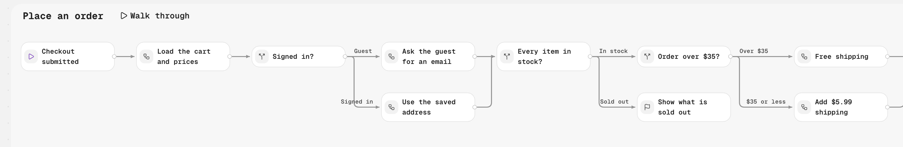
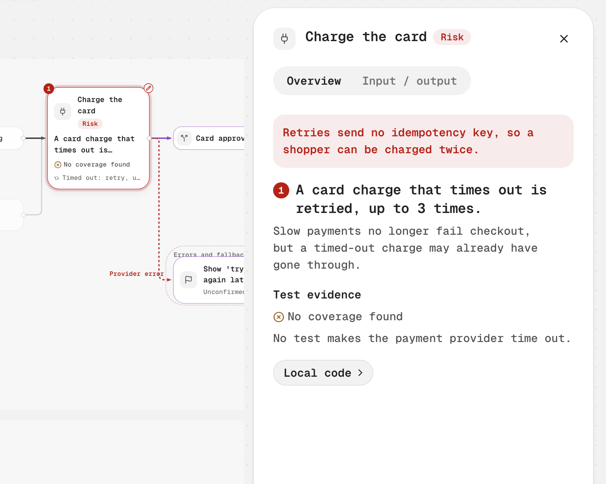

<p align="center">
  &nbsp;&nbsp;
  <picture>
    <source media="(prefers-color-scheme: dark)" srcset="assets/readme/wordmark-dark.svg">
    
  </picture>
</p>

<h1 align="center">Visualize your agent's changes.<br>See where they can break.</h1>

<p align="center">
  <a href="LICENSE"></a>
  
  <a href="https://github.com/GenesisAgentInfra/genesis/stargazers"></a>
</p>

<p align="center"><strong>English</strong> &nbsp;·&nbsp; <a href="README.zh-CN.md">简体中文</a></p>

<p align="center">
  <a href="assets/readme/genesis-demo.mp4"></a>
  <br>
  <a href="assets/readme/genesis-demo.mp4"><b>▶ Watch the 37-second demo</b></a>
</p>

Genesis turns your codebase into a business flow map and shows which of your agent's
changes are untested or risky. It runs as a skill inside Claude Code and Codex.

## Quick start

```sh
git clone https://github.com/GenesisAgentInfra/genesis.git
cd genesis
uv sync --python 3.12 --package genesis-ci --no-dev --frozen
uv run --package genesis-ci --no-dev --frozen genesis agent install --agent claude
```

Use `--agent codex` or `--agent both` if you work in Codex.

Now open your own project in Claude Code. There are two commands:

```text
/genesis map
/genesis review main
```

`map` draws the system as it is now, so you can understand it. `review` shows what
changed since a revision (here `main`) and whether a test checks it. You can also just
ask in plain language.

In Codex the skill is `$genesis`. When it finishes, open `.genesis/view.html` in a
browser. The `summary.md` next to it is ready to paste into a pull request.

## What you get

Say you asked your agent for guest checkout. It built that, and changed three other
things on the way. Genesis draws the checkout flow and puts all four changes on it:

<p align="center">
  
</p>

| What changed for shoppers | Is it tested? |
| --- | --- |
| A card charge that times out is retried up to 3 times, with no idempotency key. A shopper can be charged twice. | 🔴 Not reached. No test makes the payment time out. |
| Stock is no longer held while the card is charged. Two shoppers can pay for the last unit. | 🟡 Reached only. Tests run this code but none buys the last unit twice. |
| Shoppers can check out as a guest by leaving an email. | ⚪ Unknown. The guest test stubs out the email check. |
| Free shipping starts above $35 instead of $50. | ✅ Covered. Tests place orders at $34.99, $35.00 and $35.01. |

Click a step to see the code behind it and the tests that touch it:

<p align="center">
  
</p>

## Can I trust it?

Your agent does the reading, but it doesn't get the last word. Every step it writes has
to quote the lines of code it stands for, and the Genesis CLI checks each quote against
a frozen snapshot of your repo. If one doesn't match, the whole description is rejected
and the agent tries again. For Python, Genesis also parses the code itself, so a branch
the agent skips leaves the map marked `partial`.

The CLI calls no model, sends nothing anywhere, and never runs your code.

## Benchmark

Claude Code and Codex were asked to review 10 commits from 5 open-source Python
repositories, with and without Genesis installed, in the words a user would type:
what does this commit change, could it break anything, do the tests cover it? Each
answer was scored by automated readers against a reference answer built from the code
and its tests.

<p align="center">
  <picture>
    <source media="(prefers-color-scheme: dark)" srcset="assets/readme/benchmark-dark.svg">
    
  </picture>
</p>

|  | Claude Code | Claude Code + Genesis | Codex | Codex + Genesis |
| --- | ---: | ---: | ---: | ---: |
| Changes given a correct test-coverage verdict | 79% | 88% | 76% | 80% |
| Changes that tests run but would not catch, flagged as such | 8% | 38% | 4% | 23% |
| Affected entry points named | 32% | 47% | 15% | 24% |
| Share of named entry points that are right | 67% | 68% | 71% | 54% |
| Risks raised per run | 6.1 | 4.2 | 4.5 | 3.3 |
| &nbsp;&nbsp;real | 2.9 | 2.8 | 2.4 | 2.4 |
| &nbsp;&nbsp;not real | 2.1 | 0.7 | 1.4 | 0.5 |
| &nbsp;&nbsp;unclear from the code alone | 1.2 | 0.7 | 0.7 | 0.4 |
| Share of raised risks that are real | 44% | 64% | 54% | 72% |

With Genesis, both agents flag more of the changes that tests run but would not catch,
name more of the entry points a change affects, and raise fewer risks that fail a check
against the code. They find about as many real risks as before. For Codex, a smaller
share of the entry points it names are right. The sample is small: 10 commits, three
runs each.

What each measure means, and the full results:
[change-analysis benchmark](docs/change-analysis-benchmark.md).

## Limits

- Python gets the most accurate results, because Genesis parses it. Other languages
  work too: your agent reads the code and Genesis checks each step against the source,
  but a path the agent misses is not flagged.
- Test verdicts come from reading your tests. Genesis doesn't run them.
- Risks are what your agent noticed while reading. There is no rule engine.

## License

[Apache-2.0](LICENSE). Bundled components keep their own licenses, listed in
[NOTICE](NOTICE) and [THIRD_PARTY_NOTICES.md](THIRD_PARTY_NOTICES.md). Want to help?
See [CONTRIBUTING.md](CONTRIBUTING.md).

## Star history

<p align="center">
  <a href="https://star-history.com/#GenesisAgentInfra/genesis&Date"></a>
</p>
