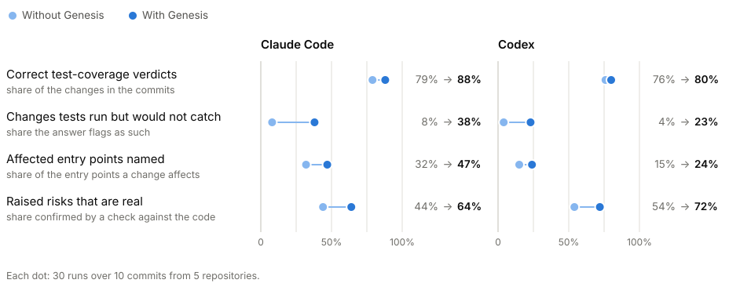

<p align="center">
  &nbsp;&nbsp;
  <picture>
    <source media="(prefers-color-scheme: dark)" srcset="assets/readme/wordmark-dark.svg">
    
  </picture>
</p>

<h1 align="center">Visualize your agent's changes.<br>See where they can break.</h1>

<p align="center">
  <a href="LICENSE"></a>
  <a href="https://github.com/GenesisAgentInfra/genesis/stargazers"></a>
  <a href="https://discord.gg/gvMxA4X7bv"></a>
  <a href="https://linux.do/"></a>
</p>

<p align="center"><strong>English</strong> &nbsp;·&nbsp; <a href="README.zh-CN.md">简体中文</a></p>

https://github.com/user-attachments/assets/673a3f9d-603c-4bcb-b20b-f152d53aa128

Genesis turns your codebase into a business flow map and shows which of your agent's
changes are untested or risky. It runs as a skill inside Claude Code and Codex, and
works on projects in Python, TypeScript, JavaScript, Go, Java, Rust and most other
common languages. Python gets the most accurate results.

## Benchmark

We gave Claude Code and Codex 10 recent commits from 5 open-source Python projects and
asked what a user would ask: what does this commit change, could it break anything, and
do the tests cover it? Each agent answered every commit three times on its own and three
times with Genesis. Every answer was scored against a reference answer built from the
code and its tests before the runs.

<p align="center">
  <picture>
    <source media="(prefers-color-scheme: dark)" srcset="assets/readme/benchmark-dark.svg">
    
  </picture>
</p>

With Genesis:

- **Changes that tests run but would not catch are flagged about five times as often.**
  A test runs such a change but would still pass if it broke, like the 🟡 stock change
  in the example below. Claude Code flagged 8% of them on its own and 38% with Genesis.
  Codex flagged 4% and 23%.
- **False alarms drop to about a third, and real risks hold steady.** So more of the
  risks an answer raises are real: 64% instead of 44% for Claude Code, 72% instead of 54%
  for Codex.
- **More of the entry points a change affects are named**: the routes, tools and
  commands that reach the changed code. Claude Code went from 32% to 47%, Codex from 15%
  to 24%.

|  | Claude Code | + Genesis | Codex | + Genesis |
| --- | ---: | ---: | ---: | ---: |
| **Do the tests cover it?** |  |  |  |  |
| Correct test-coverage verdicts | 79% | **88%** | 76% | **80%** |
| Changes tests run but would not catch, flagged | 8% | **38%** | 4% | **23%** |
| &nbsp;&nbsp;The same changes, wrongly called covered | 47% | **34%** | 43% | **30%** |
| **What does it affect?** |  |  |  |  |
| Affected entry points named | 32% | **47%** | 15% | **24%** |
| Named entry points that are right | 67% | 68% | 71% | 54% |
| **Could it break anything?** Risks raised per review: |  |  |  |  |
| &nbsp;&nbsp;Real | 2.9 | 2.8 | 2.4 | 2.4 |
| &nbsp;&nbsp;False alarms, ruled out by the code | 2.1 | **0.7** | 1.4 | **0.5** |
| &nbsp;&nbsp;Unclear from the code alone | 1.2 | 0.7 | 0.7 | 0.4 |
| Raised risks that are real | 44% | **64%** | 54% | **72%** |

Keep in mind that the first row says less than it seems. Most changes in these commits
are covered, so an answer that called every change covered would already score 82%. For Codex
it is higher on only 4 of the 10 commits. The difference is in the changes tests would
not catch, and even with Genesis about a third of those are still called covered. Codex
names more entry points with Genesis, but a smaller share of them are right. The sample
is small, 10 commits with three runs each, and the answers were scored by language-model
readers, not people. Method and full results:
[change-analysis benchmark](docs/change-analysis-benchmark.md).

## Quick start

The quickest way is to let your coding agent do it. Open your own project in the agent
and paste:

```text
Install Genesis by following https://raw.githubusercontent.com/GenesisAgentInfra/genesis/main/docs/install.md, then review my latest commit with it and tell me how to open the result.
```

Or install it yourself. You need [uv](https://docs.astral.sh/uv/getting-started/installation/)
and Git, on macOS or Linux:

```sh
uv tool install --python 3.12 "git+https://github.com/GenesisAgentInfra/genesis#subdirectory=packages/genesis_ci"
"$(uv tool dir --bin)/genesis" agent install --agent claude
```

Use `--agent codex` for Codex and `--agent both` for both. Other agents, updating,
uninstalling and troubleshooting are in the [install guide](docs/install.md).

Now open your own project in Claude Code. It has to be a Git repository with at least
one commit. Then ask for one of two things:

```text
/genesis map
/genesis review main
```

`map` draws the system as it is now, so you can understand it. `review` shows what
changed since a revision (here `main`) and whether a test checks it. You can also just
ask in plain language.

In Codex the skill is `$genesis`. When it finishes, open `.genesis/out/latest/view.html`
in a browser. The `summary.md` next to it is ready to paste into a pull request. The
[usage guide](docs/usage.md) explains the page and the other files.

Tried Genesis on a pull request? Tell us what it caught or missed in [#feedback on Discord](https://discord.gg/gvMxA4X7bv).

## What you get

Say you asked your agent for guest checkout. It built that, and changed three other
things on the way. Genesis draws the checkout flow and puts all four changes on it:

<p align="center">
  
</p>

| What changed for shoppers | Is it tested? |
| --- | --- |
| A card charge that times out is retried up to 3 times, with no idempotency key. A shopper can be charged twice. | 🔴 No coverage found. No test makes the payment time out. |
| Stock is no longer held while the card is charged. Two shoppers can pay for the last unit. | 🟡 Behavior not checked. Tests run this code but none buys the last unit twice. |
| Shoppers can check out as a guest by leaving an email. | ⚪ Coverage unclear. The guest tests take their cases from a package outside the repository, so reading them does not show what they check. |
| Free shipping starts above $35 instead of $50. | ✅ Behavior checked. Tests place orders at $34.99, $35.00 and $35.01. |

These are the labels on the page. `summary.md` calls the same verdicts not reached,
reached only, unknown and covered; the [usage guide](docs/usage.md#test-verdicts) lists
both.

Click a step to see what changed there, the test verdict with the note that explains
it, and the code behind it:

<p align="center">
  
</p>

## Can I trust it?

Your agent does the reading, but it doesn't get the last word. Every step it writes has
to quote the lines of code it stands for, and the Genesis CLI checks each quote against
a frozen snapshot of your repo. If one doesn't match, the whole description is rejected
and the agent tries again. For Python, Genesis also parses the code itself, so a branch
the agent skips leaves the result marked `partial` in `summary.md`. When you map a
project, the page also shows "Partial" at the top. A review's page does not, so check
`summary.md`.

In a review, Genesis finds the changes itself by comparing the two versions of the code,
so the list does not depend on the agent. What each change means, its test verdict and
its risks are the agent's reading. The CLI refuses a verdict only in plain cases: Behavior checked (covered) with no cited
test that asserts anything, or, for Python, No coverage found (not reached) when a test
calls the changed function directly. In other languages, whether a cited test asserts
anything is the agent's word.

The CLI calls no model, sends nothing anywhere, and never runs your code.

## Limits

- Python gets the most accurate results, because Genesis parses it. Other languages
  work too: your agent reads the code and Genesis checks each step against the source,
  but a path the agent misses is not flagged.
- Test verdicts come from reading your tests. Genesis doesn't run them.
- Risks are what your agent noticed while reading. There is no rule engine.

## Documentation

- [Install](docs/install.md): requirements, which flag for which agent, updating,
  uninstalling, and what to do when something goes wrong.
- [Use](docs/usage.md): what to ask, where the result is, how to read the page.
- [Benchmark](docs/change-analysis-benchmark.md): what was measured and the full results.
- [AGENTS.md](AGENTS.md): for a coding agent asked to install, use or change Genesis.

Questions and bug reports go to [GitHub issues](https://github.com/GenesisAgentInfra/genesis/issues).
Report a security problem privately, as [SECURITY.md](SECURITY.md) describes.

## Community

We support the [LINUX DO](https://linux.do/) community and its values of sincerity,
friendliness, solidarity, and professionalism.

## License

[Apache-2.0](LICENSE). Bundled components keep their own licenses, listed in
[NOTICE](NOTICE) and [THIRD_PARTY_NOTICES.md](THIRD_PARTY_NOTICES.md). Want to help?
See [CONTRIBUTING.md](CONTRIBUTING.md).
