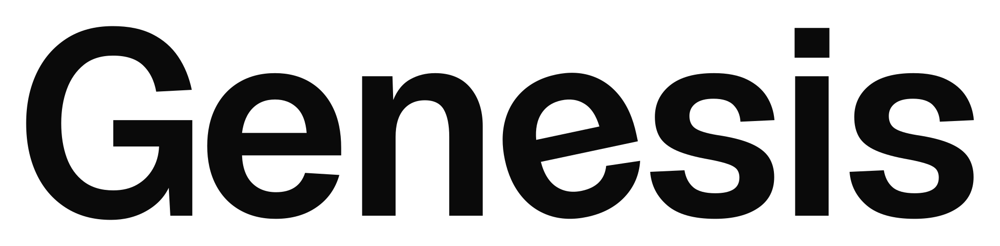

<p align="center">
  &nbsp;&nbsp;
  <picture>
    <source media="(prefers-color-scheme: dark)" srcset="assets/readme/wordmark-dark.svg">
    
  </picture>
</p>

<h1 align="center">Visualize your agent's changes.<br>See where they can break.</h1>

<p align="center">
  <a href="LICENSE"></a>
  <a href="https://github.com/GenesisAgentInfra/genesis/stargazers"></a>
</p>

<p align="center"><strong>English</strong> &nbsp;·&nbsp; <a href="README.zh-CN.md">简体中文</a></p>

https://github.com/user-attachments/assets/ceeb6ae9-0ee7-4d26-aae6-93599befc805

Genesis turns your codebase into a business flow map and shows which of your agent's
changes are untested or risky. It runs as a skill inside Claude Code and Codex, and
works on projects in Python, TypeScript, JavaScript, Go, Java, Rust and most other
common languages. Python gets the most accurate results.

## Quick start

The quickest way is to let your coding agent do it. Open your own project in the agent
and paste:

```text
Install Genesis by following https://raw.githubusercontent.com/GenesisAgentInfra/genesis/main/docs/install.md, then review my latest commit with it and tell me how to open the result.
```

Or install it yourself. You need [uv](https://docs.astral.sh/uv/getting-started/installation/)
and Git, on macOS or Linux:

```sh
uv tool install --python 3.12 "git+https://github.com/GenesisAgentInfra/genesis#subdirectory=packages/genesis_ci"
"$(uv tool dir --bin)/genesis" agent install --agent claude
```

Use `--agent codex` for Codex and `--agent both` for both. Other agents, updating,
uninstalling and troubleshooting are in the [install guide](docs/install.md).

Now open your own project in Claude Code. It has to be a Git repository with at least
one commit. Then ask for one of two things:

```text
/genesis map
/genesis review main
```

`map` draws the system as it is now, so you can understand it. `review` shows what
changed since a revision (here `main`) and whether a test checks it. You can also just
ask in plain language.

In Codex the skill is `$genesis`. When it finishes, open `.genesis/out/latest/view.html`
in a browser. The `summary.md` next to it is ready to paste into a pull request. The
[usage guide](docs/usage.md) explains the page and the other files.

## What you get

Say you asked your agent for guest checkout. It built that, and changed three other
things on the way. Genesis draws the checkout flow and puts all four changes on it:

<p align="center">
  
</p>

| What changed for shoppers | Is it tested? |
| --- | --- |
| A card charge that times out is retried up to 3 times, with no idempotency key. A shopper can be charged twice. | 🔴 No coverage found. No test makes the payment time out. |
| Stock is no longer held while the card is charged. Two shoppers can pay for the last unit. | 🟡 Behavior not checked. Tests run this code but none buys the last unit twice. |
| Shoppers can check out as a guest by leaving an email. | ⚪ Coverage unclear. The guest tests take their cases from a package outside the repository, so reading them does not show what they check. |
| Free shipping starts above $35 instead of $50. | ✅ Behavior checked. Tests place orders at $34.99, $35.00 and $35.01. |

These are the labels on the page. `summary.md` calls the same verdicts not reached,
reached only, unknown and covered; the [usage guide](docs/usage.md#test-verdicts) lists
both.

Click a step to see what changed there, the test verdict with the note that explains
it, and the code behind it:

<p align="center">
  
</p>

## Can I trust it?

Your agent does the reading, but it doesn't get the last word. Every step it writes has
to quote the lines of code it stands for, and the Genesis CLI checks each quote against
a frozen snapshot of your repo. If one doesn't match, the whole description is rejected
and the agent tries again. For Python, Genesis also parses the code itself, so a branch
the agent skips leaves the result marked `partial` in `summary.md`. When you map a
project, the page also shows "Partial" at the top. A review's page does not, so check
`summary.md`.

In a review, Genesis finds the changes itself by comparing the two versions of the code,
so the list does not depend on the agent. What each change means, its test verdict and
its risks are the agent's reading. The CLI refuses a verdict only in plain cases: Behavior checked (covered) with no cited
test that asserts anything, or, for Python, No coverage found (not reached) when a test
calls the changed function directly. In other languages, whether a cited test asserts
anything is the agent's word.

The CLI calls no model, sends nothing anywhere, and never runs your code.

## Benchmark

Claude Code and Codex were asked to review 10 commits from 5 open-source Python
repositories, with and without Genesis installed, in the words a user would type:
what does this commit change, could it break anything, do the tests cover it? Each
answer was scored by automated readers against a reference answer built from the code
and its tests.

<p align="center">
  <picture>
    <source media="(prefers-color-scheme: dark)" srcset="assets/readme/benchmark-dark.svg">
    
  </picture>
</p>

|  | Claude Code | Claude Code + Genesis | Codex | Codex + Genesis |
| --- | ---: | ---: | ---: | ---: |
| Changes given a correct test-coverage verdict | 79% | 88% | 76% | 80% |
| Changes that tests run but would not catch, flagged as such | 8% | 38% | 4% | 23% |
| Affected entry points named | 32% | 47% | 15% | 24% |
| Share of named entry points that are right | 67% | 68% | 71% | 54% |
| Risks raised per run | 6.1 | 4.2 | 4.5 | 3.3 |
| &nbsp;&nbsp;real | 2.9 | 2.8 | 2.4 | 2.4 |
| &nbsp;&nbsp;not real | 2.1 | 0.7 | 1.4 | 0.5 |
| &nbsp;&nbsp;unclear from the code alone | 1.2 | 0.7 | 0.7 | 0.4 |
| Share of raised risks that are real | 44% | 64% | 54% | 72% |

With Genesis, both agents flag more of the changes that tests run but would not catch,
name more of the entry points a change affects, and raise fewer risks that fail a check
against the code. They find about as many real risks as before. For Codex, a smaller
share of the entry points it names are right. The sample is small: 10 commits, three
runs each.

Read the first row together with the second. Most changes in these commits are covered
by a test, so an answer that called every change covered would already score
82% on the first row. For Codex the first row is higher with Genesis
on 4 of the 10 commits, equal on 1 and lower on 5. The
answers differ on the changes that tests run but would not catch: with Genesis about a
third of those readings still call the change covered (34 of 99 for
Claude Code and 30 for Codex, down from 47 and 43).

Each figure is rounded on its own, so the three kinds of risk can differ from the total
by 0.1. The last row is worked out for each run and then averaged, so it is not the
"real" row divided by the "risks raised per run" row.

What each measure means, and the full results:
[change-analysis benchmark](docs/change-analysis-benchmark.md).

## Limits

- Python gets the most accurate results, because Genesis parses it. Other languages
  work too: your agent reads the code and Genesis checks each step against the source,
  but a path the agent misses is not flagged.
- Test verdicts come from reading your tests. Genesis doesn't run them.
- Risks are what your agent noticed while reading. There is no rule engine.

## Documentation

- [Install](docs/install.md): requirements, which flag for which agent, updating,
  uninstalling, and what to do when something goes wrong.
- [Use](docs/usage.md): what to ask, where the result is, how to read the page.
- [Benchmark](docs/change-analysis-benchmark.md): what was measured and the full results.
- [AGENTS.md](AGENTS.md): for a coding agent asked to install, use or change Genesis.

Questions and bug reports go to [GitHub issues](https://github.com/GenesisAgentInfra/genesis/issues).
Report a security problem privately, as [SECURITY.md](SECURITY.md) describes.

## License

[Apache-2.0](LICENSE). Bundled components keep their own licenses, listed in
[NOTICE](NOTICE) and [THIRD_PARTY_NOTICES.md](THIRD_PARTY_NOTICES.md). Want to help?
See [CONTRIBUTING.md](CONTRIBUTING.md).
