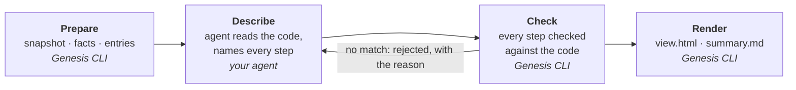

<p align="center">
  &nbsp;&nbsp;
  <picture>
    <source media="(prefers-color-scheme: dark)" srcset="assets/readme/wordmark-dark.svg">
    
  </picture>
</p>

<h3 align="center">See what your coding agent actually built.<br>Catch what each change leaves untested.</h3>

<p align="center">
  <a href="LICENSE"></a>
  
  
  
</p>

<p align="center"><strong>English</strong> &nbsp;·&nbsp; <a href="README.zh-CN.md">简体中文</a></p>

<p align="center">
  <a href="assets/readme/genesis-demo.mp4"></a>
  <br>
  <a href="assets/readme/genesis-demo.mp4"><b>▶ Watch the 37-second demo</b></a>
</p>

---

**Your coding agent writes code faster than anyone can read it.** After a day of agent
work, can you say what your product now does, and which of today's changes no test checks?

Genesis answers both, in a page anyone on the team can read:

| | What you get | What it answers |
| --- | --- | --- |
| 🗺️ | **A business flow map** of the repository: every entry point, decision, failure path and outside system, in plain language, each step tied to the lines of code it came from. | *What does this code actually do?* |
| 🔍 | **A change review** on that map: for every change since a revision (a branch, a commit, or your uncommitted work), which flow it lands on, what it changes for users, whether a test checks it, and what looks risky. | *What did this change break, or leave unchecked?* |

Your coding agent does the reading. A deterministic CLI checks every word of it against
the code, so the picture cannot drift from what the code says.

## The two jobs

### 🗺️ 1. Turn code into a business flow map

Genesis finds every way into the system (HTTP routes, CLI commands, scheduled and
background tasks, handlers registered at startup) and follows each one. Your agent names
every step in business terms, such as *"Every item in stock?"* or *"Charge the card"*.

- Branches, loops and error paths are drawn, not flattened.
- Every step links to the exact code it stands for.
- Functions left folded are marked, with how much logic sits inside.
- Calls to outside systems (payment providers, models, databases) are visible.

<p align="center">
  
</p>

### 🔍 2. Find the gaps in every change

Point Genesis at a branch, a commit range or uncommitted work. Each change is placed on
the step it alters and explained in one sentence of business impact. Then it gets a test
verdict:

| Verdict | Meaning |
| --- | --- |
| ✅ **covered** | A test takes the changed path and asserts on the result. |
| 🟡 **reached only** | Tests run the code but miss the changed path, or assert nothing about it. |
| 🔴 **not reached** | No test gets there. |
| ⚪ **unknown** | Could not be told, with the reason. |

Risks your agent spots while reading (a retry that can charge a card twice, a removed stock hold) are pinned to
the step, with the code that shows them.

<p align="center">
  
</p>

## Example: the checkout your agent just changed

You asked your coding agent for guest checkout. It built that, and changed three other
things on the way. Genesis puts every one of them on the checkout flow:

| # | What changed for shoppers | Tests |
| --- | --- | --- |
| 1 | A card charge that times out is retried, up to 3 times. **Risk:** the retry sends no idempotency key, so a shopper can be charged twice. | 🔴 not reached. No test makes the payment provider time out. |
| 2 | Items are no longer held while the card is charged. Two shoppers can pay for the last unit. | 🟡 reached only. Checkout tests run past this point, but none buys the last unit twice. |
| 3 | Shoppers can check out as a guest by leaving an email. | ⚪ unknown. The guest test stubs out the email check, so it cannot tell whether an order without an email is refused. |
| 4 | Free shipping now starts above $35 instead of $50. | ✅ covered. Tests place $34.99, $35.00 and $35.01 orders and assert which ones pay shipping. |

A fifth change (the item limit per order went from 20 to 50) touches no flow. It is listed
apart, not dropped.

The screenshots show this example: a sample shop written for this README, drawn by the
page Genesis generates.

## Why you can trust the picture

Asking an agent alone to *"draw how this repo works"* gives you a picture you cannot
check: files get skipped, steps get invented, and two runs disagree. Genesis splits the
work so that the part that must be right is not left to a model:



- **Every claim cites code.** A step must quote the lines it stands for; the CLI checks
  the quote against a frozen snapshot.
- **Nothing is silently skipped.** Every branch, called function and outside system in a
  flow must be drawn, folded into one step, or explicitly left out; folding a large
  function needs a reason. Anything else keeps
  the map marked `partial`.
- **All or nothing.** A description that does not match the code is rejected as a whole,
  with the reason, and the agent tries again.
- **Your code stays put.** The CLI calls no model and no service, and never imports or
  runs the code it reads.

## Quick start

Install the CLI outside the project you want to map, and make it available to your agent:

```sh
git clone https://github.com/GenesisAgentInfra/genesis.git
cd genesis
uv sync --python 3.12 --package genesis-ci --no-dev --frozen
uv run --package genesis-ci --no-dev --frozen genesis agent install --agent claude
```

`--agent` takes `codex`, `claude` or `both`.

Then open your project in Claude Code or Codex and ask in plain language, or call the
skill by name (`/genesis` in Claude Code, `$genesis` in Codex):

```text
/genesis map the business flows of this project
/genesis what does my uncommitted work change, and is it tested?
/genesis review this branch against main
```

The result lands in `.genesis/` in your project: `view.html` to open in a browser and
`summary.md` to paste into a pull request.

## What works today

- **Python** repositories.
- A full map of the current code, and the changes since any revision placed on it.
- Test verdicts come from **reading** test source. Genesis does not run your tests, and
  the page never says a test ran.
- Risks are your agent's observations, each backed by code evidence; there is no rule
  engine yet.

<details>
<summary><b>CLI commands</b> (your agent runs these for you)</summary>

| Command | What it does |
| --- | --- |
| `genesis agent install` | Make Genesis discoverable in your coding agent; no analysis or upload. |
| `genesis agent status` | Inspect the installed skill files. |
| `genesis map prepare` | Freeze a snapshot, extract facts and write the static skeleton. `--base` compares against a revision. |
| `genesis map plan` | Group entries into flows and create one task per flow. |
| `genesis map status` | List tasks, their state and what is still missing. |
| `genesis map context` | Everything needed to start one task. |
| `genesis map query` | Look at one symbol and its neighbours, or search the frozen source. |
| `genesis map read` | Read the frozen source behind one evidence reference. |
| `genesis map submit` | Check one submission for a task; accepted or rejected as a whole. |
| `genesis map diff` | List what changed since the base revision and where it lands on the map. |
| `genesis map render` | Write the page and the summary. `--share` leaves source excerpts out. |

</details>

<details>
<summary><b>Repository layout</b></summary>

| Path | Holds |
| --- | --- |
| `packages/genesis_ci` | The CLI: snapshot, Python fact extraction, the map workflow, the agent skill. |
| `packages/genesis_contracts` | The schemas of the files the CLI reads and writes. |
| `viewer/` | The page `genesis map render` writes, as source. |
| `fixtures/business-map` | A worked example of every contract. |

</details>

## Contributing

See [CONTRIBUTING.md](CONTRIBUTING.md).

## License

Original Genesis code is licensed under [Apache-2.0](LICENSE). Bundled components keep
their own licenses; see [NOTICE](NOTICE) and
[third-party notices](THIRD_PARTY_NOTICES.md).
