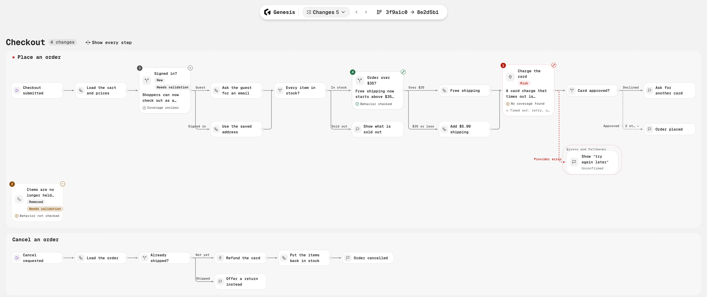
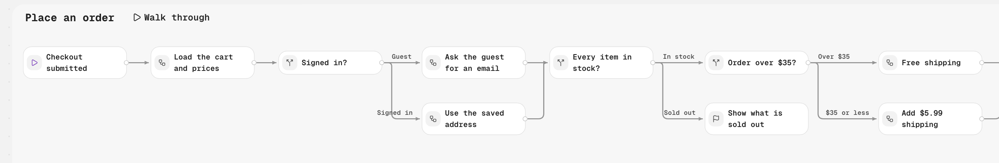
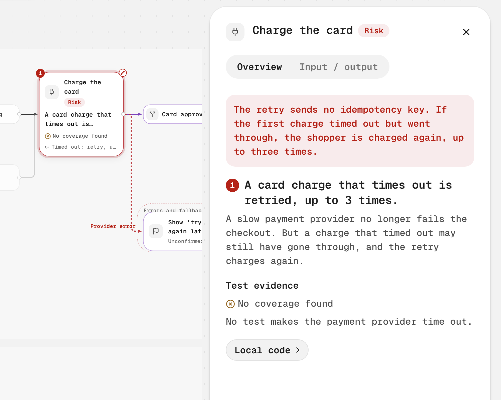
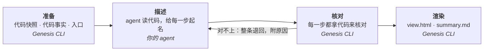

<p align="center">
  &nbsp;&nbsp;
  <picture>
    <source media="(prefers-color-scheme: dark)" srcset="assets/readme/wordmark-dark.svg">
    
  </picture>
</p>

<h3 align="center">看清你的 coding agent 到底写了什么。<br>每次改动，找出没测到的地方和新埋下的风险。</h3>

<p align="center">
  <a href="LICENSE"></a>
  
  
  
</p>

<p align="center"><a href="README.md">English</a> &nbsp;·&nbsp; <strong>简体中文</strong></p>

<p align="center">
  
</p>

---

**Coding agent 写代码的速度，已经快过任何人读代码的速度。** agent 干了一天活之后，你说得清产品现在在做什么吗？今天的改动里，哪些根本没有测试检查？

Genesis 回答这两个问题，产出一个团队里谁都看得懂的页面：

| | 你得到什么 | 回答什么问题 |
| --- | --- | --- |
| 🗺️ | **一张业务流程图**：仓库里每个入口、每个判断、每条失败路径、每个外部系统，都用大白话写出来，每一步都连着它对应的那几行代码。 | *这份代码到底在做什么？* |
| 🔍 | **一份改动审查**，就画在这张图上：相对某个版本的每一处改动（一个分支、一个提交，或者你还没提交的代码），落在哪条流程上、对用户改变了什么、有没有测试检查它、哪里看着有风险。 | *这次改动弄坏了什么，或者漏了什么没检查？* |

读代码的是你的 coding agent。一个确定性的 CLI 拿代码逐字核对它写的每一句话，所以图上画的不会偏离代码。

## 两件事

### 🗺️ 1. 把代码变成业务流程图

Genesis 找出系统的每一个入口（HTTP 接口、命令行命令、定时和后台任务、启动时注册的处理函数），沿着每个入口往下走。你的 agent 用业务语言给每一步起名，比如 “Every item in stock?”（商品是否都有库存）、“Charge the card”（扣款）。

- 分支、循环和出错路径都画出来，不会被压平。
- 每一步都能点回它对应的代码。
- 折叠起来没展开的函数会做标记，并写明里面有多少逻辑。
- 对外部系统（支付渠道、模型、数据库）的调用一眼可见。

<p align="center">
  
</p>

### 🔍 2. 找出每次改动的漏洞

让 Genesis 看一个分支、一段提交，或者还没提交的代码。每处改动都放到它改到的那一步上，用一句话说清对业务的影响，再给出测试结论：

| 结论 | 含义 |
| --- | --- |
| ✅ **有测试覆盖** | 有测试走到了改动的路径，并且检查了结果。 |
| 🟡 **只是走到** | 测试跑到了这段代码，但没走改动的那条路，或者没检查它。 |
| 🔴 **没有测试走到** | 没有任何测试到达这里。 |
| ⚪ **不确定** | 判断不了，写明原因。 |

agent 读代码时发现的风险（可能重复扣款的重试、被删掉的库存锁定）钉在对应的步骤上，附上能说明问题的代码。

<p align="center">
  
</p>

## 示例：agent 刚改完的下单流程

你让 coding agent 加一个游客下单功能。它做了，顺手还改了另外三处。Genesis 把每一处都放到了下单流程上：

| # | 对顾客改变了什么 | 测试 |
| --- | --- | --- |
| 1 | 扣款超时会自动重试，最多 3 次。**风险：** 重试没有带幂等键，顾客可能被重复扣款。 | 🔴 没有测试走到。没有测试模拟支付渠道超时。 |
| 2 | 扣款期间不再锁定库存。两个顾客可能同时买下最后一件。 | 🟡 只是走到。下单测试会经过这里，但没有测试两个人同时买最后一件。 |
| 3 | 顾客留个邮箱就能以游客身份下单。 | ⚪ 不确定。游客下单的测试把邮箱校验换成了永远通过的替身，看不出没填邮箱的订单会不会被拒。 |
| 4 | 包邮门槛从 $50 降到 $35。 | ✅ 有测试覆盖。测试分别下了 $34.99、$35.00、$35.01 的订单，并断言哪些要付运费。 |

第五处改动（每单商品数上限从 20 改成 50）不在任何流程上，单独列出来，不会被丢掉。

截图展示的就是这个例子：一家为本 README 编写的示例网店，由 Genesis 生成的页面画出来。

## 为什么这张图可信

只让 agent 自己“画一下这个仓库怎么运作”，得到的图你没法核对：会漏文件、会编步骤，跑两次结果还不一样。Genesis 把活拆开，必须准确的那部分不交给模型：



- **每句话都有代码出处。** 每一步都要引用它代表的那几行代码，CLI 在冻结的快照里核对引文。
- **不会悄悄漏掉。** 流程里的每个分支、每个被调用的函数、每个外部系统，要么画出来，要么折叠成一步，要么明确写出不画；折叠一个大函数要写原因。做不到的，图就一直标着 `partial`。
- **要么全收，要么全退。** 跟代码对不上的描述整条退回，附上原因，agent 改了再交。
- **不动你的代码。** CLI 不调用任何模型和服务，也从不导入或运行它读到的代码。

## 快速开始

在你要分析的项目之外安装 CLI，并让你的 agent 能用上它：

```sh
git clone https://github.com/GenesisAgentInfra/genesis.git
cd genesis
uv sync --python 3.12 --package genesis-ci --no-dev --frozen
uv run --package genesis-ci --no-dev --frozen genesis agent install --agent claude
```

`--agent` 可以是 `codex`、`claude` 或 `both`。

然后在 Claude Code 或 Codex 里打开你的项目，直接用大白话问，或者按名字调用技能（Claude Code 里是 `/genesis`，Codex 里是 `$genesis`）：

```text
/genesis 画出这个项目的业务流程
/genesis 我还没提交的代码改了什么，有没有测试？
/genesis 对比 main 审查一下这个分支
```

结果写在你项目的 `.genesis/` 下：`view.html` 用浏览器打开，`summary.md` 可以直接贴进 PR。

## 目前能做什么

- **Python** 仓库。
- 当前代码的完整流程图，以及相对任意版本的改动在图上的位置。
- 测试结论来自**阅读**测试源码。Genesis 不运行你的测试，页面也从不声称测试跑过。
- 风险是 agent 读代码时的观察，每一条都有代码依据；目前还没有规则引擎。

<details>
<summary><b>CLI 命令</b>（由你的 agent 替你运行）</summary>

| 命令 | 作用 |
| --- | --- |
| `genesis agent install` | 让你的编码助手能发现 Genesis；不做分析，也不上传。 |
| `genesis agent status` | 查看已安装的技能文件。 |
| `genesis map prepare` | 冻结快照、提取事实并写出静态骨架。`--base` 指定对比的版本。 |
| `genesis map plan` | 把入口归成流程，每条流程建一个任务。 |
| `genesis map status` | 列出任务、状态以及还缺什么。 |
| `genesis map context` | 开始一个任务所需的全部材料。 |
| `genesis map query` | 查看一个符号及其相邻符号，或在冻结的源码里搜索。 |
| `genesis map read` | 读取某条依据背后的冻结源码。 |
| `genesis map submit` | 校验某个任务的一次提交；整体接受或整体拒绝。 |
| `genesis map diff` | 列出相对基准版本改了什么，以及落在图上的哪里。 |
| `genesis map render` | 写出页面和摘要。`--share` 不带源码片段。 |

</details>

<details>
<summary><b>仓库结构</b></summary>

| 路径 | 内容 |
| --- | --- |
| `packages/genesis_ci` | CLI：快照、Python 事实提取、流程图工作流、助手技能。 |
| `packages/genesis_contracts` | CLI 读写的文件的结构定义。 |
| `viewer/` | `genesis map render` 写出的页面的源码。 |
| `fixtures/business-map` | 每份结构定义的完整示例。 |

</details>

## 参与开发

见 [CONTRIBUTING.md](CONTRIBUTING.md)。

## 许可证

Genesis 的原创代码以 [Apache-2.0](LICENSE) 授权。随附的组件保留各自的许可证，见 [NOTICE](NOTICE) 和[第三方声明](THIRD_PARTY_NOTICES.md)。
