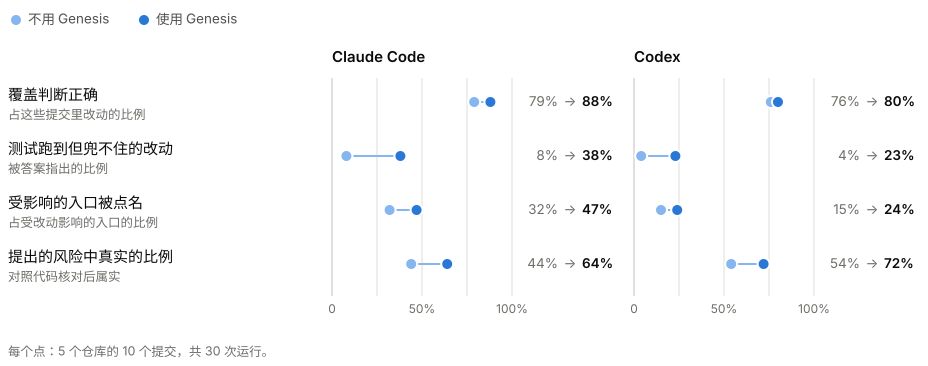

# 变更分析评测

<a href="change-analysis-benchmark.md">English</a> &nbsp;·&nbsp; <strong>简体中文</strong>

这一页给出 [README](../README.zh-CN.md) 里那组对比的完整结果，并说明每个指标的含义。

评测要回答的问题是：用户问 coding agent“这个提交改了什么、会不会弄坏别的功能、测试能不能兜住”时，装了 Genesis 和没装，答案有什么不同。

- [比了什么](#比了什么)
- [标准答案](#标准答案)
- [答案怎么计分](#答案怎么计分)
- [指标](#指标)
- [结果](#结果)
- [怎么看这些数字](#怎么看这些数字)

## 比了什么

两个 coding agent，各有装和不装 Genesis 两种配置：

| 配置 | agent 和模型 | 项目里装了什么 |
| --- | --- | --- |
| Claude Code | Claude Code 2.1.322，`claude-opus-5-5`，effort high | 无 |
| Claude Code + Genesis | 同上 | Genesis skill 和 CLI |
| Codex | Codex CLI 0.142.2，`gpt-6-astra`，reasoning effort high | 无 |
| Codex + Genesis | 同上 | Genesis skill 和 CLI |

Genesis 由提交 `91b832e` 构建，用 `genesis agent install --agent <claude|codex> --scope project --repo <仓库副本>` 安装。同一个 agent 的两种配置之间没有别的差别：每次运行都从被分析的那个提交的一份全新仓库副本开始，提问也相同。

每种配置对 10 个提交各回答 3 次：每种配置 30 次运行，一共 120 次。

### 提问

一共六种问法，三种英文、三种中文，都是用户平时会说的话。其中两种：

> Can you review the latest commit for me? What does it change, which parts of the
> product does it touch, could it break anything, and do the existing tests cover it?

> 帮我看下最新这个提交改了些什么，会不会影响到别的功能？现有的测试能不能兜住，有没有什么风险？

每个提交的每一次重复用六种里的一种，四种配置用的是同一种。提问不要求格式，也都没有提到 Genesis：用不用由 agent 自己决定。装了 Genesis 的 60 次运行里，agent 每次都用了。

### 仓库和提交

五个仓库是按固定规则选出的，不是人工挑的：在 GitHub 上搜索 agent、LLM、MCP、RAG 类的 Python 项目，要求许可证宽松、至少 200 个 star；按 star 数从高到低，取最先符合条件的五个：规模中等（源码 8,000 到 25,000 个非空行），有测试、有锁文件，并且有两个符合下面规则的提交。开发 Genesis 时用过的仓库一律跳过，所以 Genesis 此前从没有在这五个仓库上运行过。这里的“源码”指项目自身包里的 Python 文件，不含测试。

每个仓库同样按规则取两个近期的提交：至少改动两个源文件，这些文件里改动 40 到 250 行，不是合并提交、版本号变更或只改文档，并且至少有三个计分单元。行数按新增加删除计算，不算空行、只有注释的行和 docstring。提交里的其他文件，比如测试、前端代码、脚本和文档，都不计入。

| 仓库 | 提交 | 计分单元 | 已覆盖 | 仅执行到 | 不计分 |
| --- | --- | ---: | ---: | ---: | ---: |
| [Azure-Samples/chat-with-your-data-solution-accelerator](https://github.com/Azure-Samples/chat-with-your-data-solution-accelerator) | [`6489e85`](https://github.com/Azure-Samples/chat-with-your-data-solution-accelerator/commit/6489e85ad2f62ec37bd256c0ed852410289a918e) | 7 | 5 | 2 | 1 |
| [Azure-Samples/chat-with-your-data-solution-accelerator](https://github.com/Azure-Samples/chat-with-your-data-solution-accelerator) | [`d211e98`](https://github.com/Azure-Samples/chat-with-your-data-solution-accelerator/commit/d211e9896db9c6ff0223bdd9834b2f8ca7718151) | 12 | 12 | 0 | 0 |
| [OpenOSINT/OpenOSINT](https://github.com/OpenOSINT/OpenOSINT) | [`6f6c9a8`](https://github.com/OpenOSINT/OpenOSINT/commit/6f6c9a83ca7fc85a423987aa03ea7e5f8ab9fb97) | 13 | 11 | 2 | 1 |
| [OpenOSINT/OpenOSINT](https://github.com/OpenOSINT/OpenOSINT) | [`ec1bc82`](https://github.com/OpenOSINT/OpenOSINT/commit/ec1bc826dc0d288bb596fa378cdff350c562634d) | 15 | 14 | 1 | 7 |
| [Taxuspt/garmin_mcp](https://github.com/Taxuspt/garmin_mcp) | [`496741d`](https://github.com/Taxuspt/garmin_mcp/commit/496741ddd9d6bf6810e8fb3a092ebd512762e496) | 16 | 10 | 6 | 0 |
| [Taxuspt/garmin_mcp](https://github.com/Taxuspt/garmin_mcp) | [`808407a`](https://github.com/Taxuspt/garmin_mcp/commit/808407a34cacf59906e66a2d129d8e6dfe9c4f8d) | 22 | 18 | 4 | 3 |
| [dbt-labs/dbt-mcp](https://github.com/dbt-labs/dbt-mcp) | [`201148d`](https://github.com/dbt-labs/dbt-mcp/commit/201148d7ef294abfd4ba6bfd52141e6fba91b1bf) | 42 | 28 | 14 | 1 |
| [dbt-labs/dbt-mcp](https://github.com/dbt-labs/dbt-mcp) | [`db9e8f2`](https://github.com/dbt-labs/dbt-mcp/commit/db9e8f2ac2d33abd85843ae3d3012c3476b8e48a) | 8 | 7 | 1 | 7 |
| [microsoft/typeagent-py](https://github.com/microsoft/typeagent-py) | [`6ac73a8`](https://github.com/microsoft/typeagent-py/commit/6ac73a8c4b324bc0c6e7b46368d144f125343e83) | 10 | 8 | 2 | 4 |
| [microsoft/typeagent-py](https://github.com/microsoft/typeagent-py) | [`be4a162`](https://github.com/microsoft/typeagent-py/commit/be4a16281a269bded6249666bad559bed7173ea4) | 8 | 7 | 1 | 2 |
| **合计** |  | 153 | 120 | 33 | 26 |

各列的含义见下一节。

## 标准答案

每个提交有一份标准答案，在运行之前通过读代码建立。建立时没有用到任何 agent 的答案，也没有用到 Genesis 的任何输出。这一页里说的“读者”都是按书面说明工作的语言模型会话，不是人。

### 改动单元

一个**单元**是代码里一处独立的改动：一个新增或修改的分支、一个改了的默认值或常量、一个新函数、一个改了的装饰器、一个被删掉的定义。只有项目的 Python 源码产生单元；测试文件、其他语言、注释和格式调整不产生单元。

### 每个单元的覆盖等级

有些单元没有什么可让测试去发现的，不定等级：不改变行为的重构、纯删除、只挪了位置的定义。其余的单元都是**计分**单元。两个读者各自独立地读代码和测试，给每个计分单元定一个等级：

| 等级 | 含义 |
| --- | --- |
| **已覆盖** | 项目默认测试命令会运行的某个测试走到了改动的代码，并且只把这个单元撤回后，这个测试会失败。 |
| **仅执行到** | 这样的测试运行了这段代码，但撤回这个单元后它仍然通过：没走改动的那条路径，或者没检查改动影响的结果。 |
| **未覆盖** | 没有这样的测试运行这段代码。 |
| **无法判断** | 只靠阅读定不下来。 |

在 Genesis 的 `summary.md` 里，这四个等级分别叫 covered、reached only、not reached 和 unknown；页面上显示为“有行为验证”“缺少行为验证”“未找到覆盖”“覆盖待确认”（对照表见[测试结论](usage.zh-CN.md#测试结论)）。

这比行覆盖率严格。行覆盖率里，一行代码只要被任何测试执行过就算覆盖；这里的“已覆盖”问的是：把这处改动撤回去，测试能不能发现。每个计分单元都有一个只撤回它自己的补丁，读者对照这个补丁来判断。默认被跳过的测试不算；把改动的函数换成桩的测试也不算。

两个读者给出相同等级时，这个单元才有等级；在这些提交上，两者对每个计分单元的判断都一致。

标准答案一共 179 个单元，其中 153 个是计分单元：120 个已覆盖，33 个仅执行到（没有“未覆盖”的）。其余 26 个不计入覆盖指标：20 个重构，4 个删除，2 个挪动。

### 入口

入口是从外部进入代码的途径，比如 HTTP 路由、MCP 工具、CLI 命令和后台任务。对每个单元，标准答案列出行为会被它改变的入口：从这些入口进来，存在某个输入能走到改动的代码。

## 答案怎么计分

答案是自由文本，分三步变成数字：

1. **按单元判读。** 读者拿到整篇答案和这个提交的单元列表（不带标准答案的等级），记下答案给每个单元的等级；答案没有谈到这个单元的测试时记为“无”。
2. **抽取。** 抽取者列出答案描述的改动、为每个改动点名的入口，以及提出的风险。
3. **核对。** 核对者读提交前后的代码，逐条判断答案提出的每条风险。

读者、抽取者和核对者都是按书面说明工作的语言模型会话，没有人工评分。它们不知道答案来自哪种配置。五分之一的答案被独立地判读了第二遍：两遍给出相同等级的单元，按配置不同占 95% 到 97%。五分之一的风险被核对了第二遍：两次判定相同的，在 Claude Code 两种配置的风险里占 89%，在 Codex 两种配置的风险里占 92%。

## 指标

每个指标先按每次运行分别计算。一个提交的值是它三次运行的平均，表里的数字是 10 个提交的平均。写成“x / n”的行是所有运行合计的次数。某个指标在某次运行或某个提交上没有值时（比如答案没有点名任何入口，精确率就没有值），不计入平均。

### 测试覆盖

- **覆盖准确率。** 一个提交的计分单元里，答案给出的等级和标准答案一致的比例。答案没提到的单元，或者没谈它的测试的单元，算错。
- **已给出判断的准确率。** 同上，但只看答案给了等级的单元。它把“说错了”和“没说”分开。
- **给出判断的比例。** 计分单元里答案给了等级的比例。

  例子：一个提交有 10 个计分单元，答案判对 8 个，判错 1 个，没提 1 个。覆盖准确率是 80%，已给出判断的准确率是 8/9（89%），给出判断的比例是 90%。
- **按标准答案等级看。** 同样这些判读，把“已覆盖”和“仅执行到”的单元分开数，三次运行都算：每种配置有 120 × 3 = 360 次对“已覆盖”单元的判读，33 × 3 = 99 次对“仅执行到”单元的判读。
- **虚假的安全感。** 99 次对“仅执行到”单元的判读里，答案说成“已覆盖”的次数。这是代价最大的错误：用户以为有测试护着这处改动，其实没有测试能发现它出问题。

这些提交里大多数单元是已覆盖的，所以一个把所有单元都说成“已覆盖”的答案，覆盖准确率也能到 82%。答案之间的差别主要出在“仅执行到”的单元上，所以把它们单独统计。

### 入口

对每个单元，把答案为它点名的入口和标准答案的入口相比较。

- **入口召回率。** 标准答案的入口里，答案点到名的比例。答案没提到的单元，召回率记为 0。
- **入口精确率。** 答案点名的入口里，在标准答案中的比例。

两者都在一个提交的单元上取平均，删除不算在内。标准答案里没有入口的单元不计入召回率，答案没有为它点名入口的单元不计入精确率。只有逐个点名的入口才算：“所有管理路由”这样的说法不计分。

例子：标准答案里某个单元有入口 A、B、C。答案点了 A、B，还点了两个不在标准答案里的。召回率是 2/3，精确率是 2/4。

- **每次运行点名的入口数。** 个数，只作参考：列得多不等于列得好。

### 找到的改动

- **改动召回率。** 标准答案的单元里，答案提到了的比例，不管说得对不对。分两部分报告：提交说明里写到的单元（agent 照着提交说明复述就能提到），和提交说明没写到的单元（只有读 diff 才能发现）。挪动不算在内。其余的单元里，提交说明写到的有 117 个，没写到的有 60 个。有两个提交的说明一个单元也没写到，所以第一部分是 8 个提交的平均。
- **每次运行列出的改动数。** 个数，只作参考。

Genesis 的改动列表是直接从 diff 生成的，所以改动召回率天生对它有利。

### 风险

答案提出的每条风险都对照代码核对。只给评级（“低”“无”）或者说不会出问题的，不算提出了风险。

| 判定 | 含义 |
| --- | --- |
| **真实** | 按提交之后的代码，这个问题确实可能发生，并且是这次改动带来的：具体的失败、错误结果、调用方被弄坏、数据丢失、安全或兼容问题。 |
| **不成立** | 代码排除了这种情况，这条说法读错了代码，或者和这次改动无关，比如泛泛地建议补测试。 |
| **无法判断** | 只看代码定不下来：取决于运行时的数据、外部服务或作者的意图。 |

- **每次运行提出的风险**，以及其中真实、不成立、无法判断各有多少。每个数字各自四舍五入，所以三项相加可能和总数差 0.1。
- **提出的风险中真实的比例。** 真实的条数除以提出的条数，先按每次运行计算再取平均，所以它不完全等于“其中真实”那一行除以“每次运行提出的风险”那一行。

风险按条计数，不区分严重程度。

## 结果

README 重点展示了 agent 正确指出“仅执行到”这类测试盲点的次数。下表列出两个 agent 各自的次数和其他指标的完整结果。

  <picture>
    <source media="(prefers-color-scheme: dark)" srcset="../assets/readme/benchmark-zh-dark.svg">
    
  </picture>

### Claude Code

| 指标 | 不用 Genesis | 使用 Genesis |
| --- | ---: | ---: |
| **测试覆盖** |  |  |
| 覆盖准确率 | 79% | 88% |
| 已给出判断的准确率 | 88% | 89% |
| 给出判断的比例 | 90% | 99% |
| “已覆盖”单元被判为已覆盖 | 339 / 360 | 349 / 360 |
| “仅执行到”单元被判为仅执行到 | 8 / 99 | 38 / 99 |
| 虚假的安全感：“仅执行到”单元被判为已覆盖 | 47 / 99 | 34 / 99 |
| **入口** |  |  |
| 入口召回率 | 32% | 47% |
| 入口精确率 | 67% | 68% |
| 每次运行点名的入口数 | 3.8 | 6.3 |
| **找到的改动** |  |  |
| 改动召回率（提交说明提到的单元） | 96% | 98% |
| 改动召回率（提交说明没提到的单元） | 69% | 75% |
| 每次运行列出的改动数 | 6.9 | 7.0 |
| **风险** |  |  |
| 每次运行提出的风险 | 6.1 | 4.2 |
| 其中真实 | 2.9 | 2.8 |
| 其中不成立 | 2.1 | 0.7 |
| 其中无法判断 | 1.2 | 0.7 |
| 提出的风险中真实的比例 | 44% | 64% |

### Codex

| 指标 | 不用 Genesis | 使用 Genesis |
| --- | ---: | ---: |
| **测试覆盖** |  |  |
| 覆盖准确率 | 76% | 80% |
| 已给出判断的准确率 | 87% | 92% |
| 给出判断的比例 | 87% | 87% |
| “已覆盖”单元被判为已覆盖 | 330 / 360 | 333 / 360 |
| “仅执行到”单元被判为仅执行到 | 4 / 99 | 23 / 99 |
| 虚假的安全感：“仅执行到”单元被判为已覆盖 | 43 / 99 | 30 / 99 |
| **入口** |  |  |
| 入口召回率 | 15% | 24% |
| 入口精确率 | 71% | 54% |
| 每次运行点名的入口数 | 1.8 | 4.4 |
| **找到的改动** |  |  |
| 改动召回率（提交说明提到的单元） | 90% | 92% |
| 改动召回率（提交说明没提到的单元） | 55% | 55% |
| 每次运行列出的改动数 | 5.4 | 5.0 |
| **风险** |  |  |
| 每次运行提出的风险 | 4.5 | 3.3 |
| 其中真实 | 2.4 | 2.4 |
| 其中不成立 | 1.4 | 0.5 |
| 其中无法判断 | 0.7 | 0.4 |
| 提出的风险中真实的比例 | 54% | 72% |

### 按标准答案等级看判断

下表是次数，每个提交的三次运行都算在内。每一列的两段分别合计 360 和 99。

| 标准答案的等级，以及答案怎么说 | Claude Code | Claude Code + Genesis | Codex | Codex + Genesis |
| --- | ---: | ---: | ---: | ---: |
| **已覆盖**（360 次判读） |  |  |  |  |
| 已覆盖（正确） | 339 | 349 | 330 | 333 |
| 仅执行到 | 5 | 4 | 7 | 1 |
| 未覆盖或无法判断 | 3 | 2 | 4 | 6 |
| 没给判断或没提到 | 13 | 5 | 19 | 20 |
| **仅执行到**（99 次判读） |  |  |  |  |
| 仅执行到（正确） | 8 | 38 | 4 | 23 |
| 已覆盖 | 47 | 34 | 43 | 30 |
| 未覆盖或无法判断 | 9 | 21 | 6 | 9 |
| 没给判断或没提到 | 35 | 6 | 46 | 37 |

### 各提交的覆盖准确率

| 提交 | Claude Code | Claude Code + Genesis | Codex | Codex + Genesis |
| --- | ---: | ---: | ---: | ---: |
| chat-with-your-data-solution-accelerator `6489e85` | 76% | 86% | 67% | 62% |
| chat-with-your-data-solution-accelerator `d211e98` | 100% | 100% | 83% | 100% |
| OpenOSINT `6f6c9a8` | 85% | 100% | 79% | 97% |
| OpenOSINT `ec1bc82` | 89% | 93% | 93% | 89% |
| garmin_mcp `496741d` | 60% | 75% | 56% | 75% |
| garmin_mcp `808407a` | 83% | 97% | 79% | 88% |
| dbt-mcp `201148d` | 61% | 67% | 60% | 60% |
| dbt-mcp `db9e8f2` | 67% | 83% | 67% | 63% |
| typeagent-py `6ac73a8` | 80% | 80% | 80% | 80% |
| typeagent-py `be4a162` | 88% | 96% | 92% | 88% |
| **平均** | 79% | 88% | 76% | 80% |

使用 Genesis 后，Claude Code 的覆盖准确率在 10 个提交里有 8 个更高、2 个相同；Codex 有 4 个更高、1 个相同、5 个更低（按四舍五入之前的数值比较：dbt-mcp `201148d` 上 Codex 的两个值是 60.3% 和 59.5%）。

### 用了 Genesis 之后，哪些变了，哪些没变

- **“仅执行到”的单元。** 不用 Genesis 时，两个 agent 很少能认出来：99 次判读里只有 8 次和 4 次。使用 Genesis 后是 38 次和 23 次。虚假的安全感在 Claude Code 上从 47 次降到 34 次，在 Codex 上从 43 次降到 30 次。把这类单元说成未覆盖或无法判断的次数变多了：Claude Code 从 9 次到 21 次，Codex 从 6 次到 9 次。
- **“已覆盖”的单元。** 变化很小：四种配置在 360 次里判对 330 到 349 次。
- **给出判断的比例。** Claude Code 使用 Genesis 后对 99% 的计分单元给出了判断，原来是 90%。Codex 保持在 87%。
- **入口。** 两个 agent 的召回率都提高了。精确率在 Claude Code 上基本不变（67% 和 68%），在 Codex 上从 71% 降到 54%。
- **找到的改动。** 改动召回率变化不大。提交说明没提到的单元，Claude Code 从 69% 到 75%，Codex 两种配置都是 55%。
- **风险。** 使用 Genesis 后，两个 agent 提出的风险都变少了，其中核对不成立的也变少了：Claude Code 每次运行从 2.1 条降到 0.7 条，Codex 从 1.4 条降到 0.5 条。每次运行找到的真实风险数基本不变。

## 怎么看这些数字

- **样本小。** 五个 Python 仓库的十个提交，每个三次运行，每个 agent 只用了一个模型。单个提交上的差别有正有负，各提交的表里可以看到。
- **覆盖是读出来的，不是跑出来的。** 标准答案的等级是两个读者读代码和测试得出的结论，没有为此执行测试。
- **由模型计分。** 标准答案和计分都来自语言模型会话，它们之间互相核对过，但没有和人工评审比对。
- **入口必须点名。** 答案写“所有管理路由”，它指的那些路由不会得分。
- **尺子和 Genesis 用的是同一把。** 标准答案的四个等级，以及背后的判断标准（把改动撤回，测试会不会失败），和 Genesis skill 让 agent 下判断时用的一样。提问只是用用户平时的说法问测试能不能兜住，没有提这四个等级。这组运行没有测过：直接要求没装 Genesis 的 agent 区分“已覆盖”和“仅执行到”会怎样；也分不出提升里有多少来自 skill 的要求，多少来自 CLI 给出的事实。
